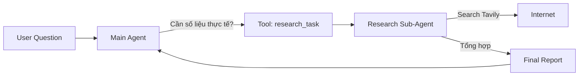

# 🕵️ RESEARCH AGENT SPECIFICATION

> **Phiên bản:** 1.0
> **Module:** `app.core.features.research_agent`
> **Vai trò:** Sub-Agent chuyên trách tìm kiếm, xác thực và tổng hợp dữ liệu thời gian thực.

---

## 1. TỔNG QUAN (OVERVIEW)

Research Agent là một **Sub-Agent** hoạt động độc lập dưới sự điều phối của Main Graph. Nó được thiết kế để giải quyết vấn đề "ảo giác" (hallucination) của LLM bằng cách buộc model phải truy xuất dữ liệu từ các nguồn uy tín (Google Search) trước khi trả lời.

### Mục tiêu cốt lõi:
1.  **Deep Search:** Không chỉ tìm kiếm bề mặt, mà phân tích ý định (Intent) để chọn chiến lược tìm kiếm.
2.  **Structured Data:** Trả về dữ liệu có cấu trúc (Bảng, Danh sách) thay vì văn bản thuần túy.
3.  **Fact-Checking:** Đối chiếu dữ liệu từ nhiều nguồn để đảm bảo độ chính xác.

---

## 2. KIẾN TRÚC & LUỒNG XỬ LÝ (ARCHITECTURE & FLOW)

### 2.1. Integrate vào Main Graph
Research Agent được đóng gói dưới dạng một **Tool** (`research_task`) để Main Agent có thể gọi khi cần thiết.

### 2.2. Giao thức tư duy (Thinking Protocol)
Agent tuân thủ quy trình 4 bước nghiêm ngặt (định nghĩa trong `prompts/sub_agents/researcher.md`):

1.  **ANALYZE (Phân tích):** Xác định Intent (Comparison, Aggregation, Fact-Check, Roadmap).
2.  **STRATEGY (Chiến lược):** Xây dựng "One-Shot Query" (cố gắng tìm trong 1 lần) hoặc "Iterative Search" (tìm nhiều lần).
3.  **SYNTHESIZE (Tổng hợp):** Chuẩn hóa số liệu, loại bỏ tin rác/quảng cáo.
4.  **REPORT (Báo cáo):** Trình bày kết quả theo Schema quy định.

---

## 3. CẤU HÌNH INPUT/OUTPUT

### 3.1. Input Parameters
Khi gọi `research_task`, Main Agent cần cung cấp:

| Tham số | Kiểu | Mô tả |
|:---|:---|:---|
| `query` | `string` | Câu hỏi hoặc yêu cầu tìm kiếm cụ thể. |
| `intent` | `string` | Mục đích tìm kiếm (`comparison`, `aggregation`, `fact_check`, `roadmap`). |

### 3.2. Structured Output (Schema)
Để tránh lỗi format, Output được ép kiểu cứng bằng Pydantic models (trong `app/schemas/research_output.py`):

- **ComparisonOutput:** Bảng so sánh 2 đối tượng (Học phí, Điểm chuẩn...).
- **AggregationOutput:** Danh sách xếp hạng, Top list.
- **FactCheckOutput:** Câu trả lời ngắn gọn kèm dẫn chứng số liệu.
- **RoadmapOutput:** Lộ trình từng bước có timeline.

---

## 4. CHIẾN LƯỢC TÌM KIẾM (SEARCH STRATEGY)

### 4.1. Công cụ tìm kiếm (`search_tavily`)
Sử dụng Tavily Search API với các tối ưu:
- **Query Enhancement:** Tự động thêm năm hiện tại (2024, 2025), từ khóa context ("điểm chuẩn", "tuyển sinh").
- **Rate Limit Handling:** Xử lý lỗi 429, timeout tự động.

### 4.2. Anti-Laziness Guard
Hệ thống có cơ chế "chống lười" cho Agent:
- **Force Search:** Nếu turn đầu tiên Agent định trả lời ngay mà không search -> Hệ thống chặn lại và bắt buộc gọi tool.
- **Force Expert Insight:** Nếu output thiếu phần phân tích chuyên gia -> Cảnh báo yêu cầu bổ sung.

---

## 5. HƯỚNG DẪN BẢO TRÌ (MAINTENANCE)

### Khi sửa Prompt (`prompts/sub_agents/researcher.md`):
- **DO:** Cập nhật các ví dụ (Few-Shot) nếu thấy Agent hay sai format.
- **DON'T:** Thay đổi cấu trúc 4 bước (Analyze -> Strategy -> Synthesize -> Report) vì code logic dựa vào flow này.

### Khi thêm Intent mới:
1. Cập nhật `research_task` signature trong `research_agent.py`.
2. Định nghĩa Schema mới trong `research_output.py`.
3. Thêm hướng dẫn xử lý Intent đó vào Prompt.
